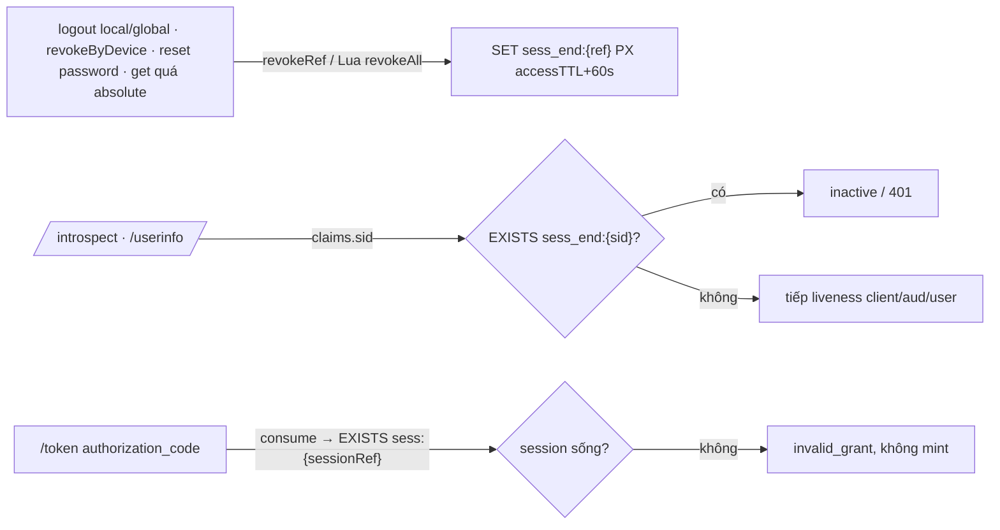

# Tech Lead Review — 2026-10-12

## Kết luận: PASS (kèm chỉnh sửa bắt buộc đã fold vào `tasks.md`, đánh dấu *(tech-lead fold)*)

Đối chiếu code thật (CodeGraph): `introspect.controller.ts:132` (liveness đang chạy TRƯỚC authz, đúng như DEBT-040), `access-token-liveness.ts:31`, `token.service.ts:76/161/186`, `refresh-token.service.ts` (`rotate` kế thừa `sessionRef`, `RotationResult` CHƯA mang `sessionRef`), `session.service.ts` (`revokeRef`, Lua `sessionRevokeAll`, `get` tự revoke khi quá absolute), `ui.controller.ts:214` (logout), `authentication.service.ts:179` (reset password → `sessions.revokeAllForUser`), `authorize.service.ts:306/327` (MỌI đường mint code đều set `sessionRef`), `token.controller.ts:134`, `logout.service.ts:91`, `userinfo.controller.ts:70`.

Plan đúng hướng, chia task hợp lý, nhưng **Task 2 như viết sẽ phá `offline_access`** (xem V1) và có vài khẳng định sai về exposure/legacy window. Các lỗi này sửa được bằng fold, không cần quay lại analyst.

## Kiến trúc đề xuất (điều chỉnh)

Giữ modular monolith hiện tại; không thêm module/service. Thay "allowlist session sống" bằng **tombstone kết thúc phiên** cho access token:

- **AT** (`/introspect`, `/userinfo`): chết khi phiên bị **chấm dứt chủ động** (tombstone), KHÔNG chết khi phiên hết hạn tự nhiên.
- **Authorization code** (`/token`): yêu cầu phiên **còn sống** (`sess:{ref}` tồn tại) — user-present, cửa sổ ≤60s.

## Quyết định chốt

**Q-A — `sid` = `sessionRef` (sha256 cookie id). CHẤP NHẬN, nhưng sửa lập luận.**
- Sai trong tasks: "ẩn `sid` khỏi mọi output" là không thể — access token là JWT đọc được bởi RP (client giữ token) và RS. `sid` **sẽ** lộ cho RP/RS dù không nằm trong body introspect.
- Lý do chấp nhận: `ref` là băm một chiều của 256-bit CSPRNG, không đảo được thành cookie (comment `Session.ref` đã định nghĩa "safe to show"); không endpoint nào nhận `ref` làm credential (`revokeByDevice` kiểm ownership). `sub` vốn đã toàn cục (không pairwise) nên `sid` không thêm kênh tương quan đáng kể. Phương án B (sid ngẫu nhiên + map `sid→ref`) thêm key Redis, thêm chỗ lệch Cluster (DEBT-013) mà không giảm rủi ro thực.
- Invariant mới BẮT BUỘC: **`sid`/`ref` là định danh công khai, KHÔNG phải capability** — không endpoint nào được hành động theo `sid`/`ref` do client gửi mà không kiểm ownership qua phiên đã xác thực. Body `/introspect` vẫn KHÔNG trả `sid` (tối thiểu hoá, không cần). Không log token; `ref` đã có trong audit `targetId` — giữ.
- Dev sửa comment `refresh-token.schema.ts` ("never exposed in token/response" → không còn đúng).
- Nếu sau này có pairwise `sub`/yêu cầu privacy giữa RP → `sid` phải theo-RP → **DEBT-047**.

**Q-B — Phiên chết ⇒ AT inactive ngay? KHÔNG cho hết hạn tự nhiên; CÓ cho chấm dứt chủ động.**
- Lỗi thiết kế V1: refresh family kế thừa `sessionRef` (refresh 30d) trong khi session idle 8h. Theo tasks, AT mint từ refresh sau khi phiên idle-expire mang `sid` của phiên đã chết ⇒ inactive ngay ⇒ mọi `/userinfo` sau 8h không hoạt động ⇒ `offline_access` vô dụng (OIDC Core §11: offline = truy cập khi user vắng mặt).
- Chốt: kiểm **tombstone** `sess_end:{ref}` (ghi khi `revokeRef` + Lua `sessionRevokeAll`, TTL = `accessTokenTtl + 60s`), không kiểm `sess:{ref}` tồn tại. AT từ refresh vẫn mang `sid` = `sessionRef` của family ⇒ logout chủ động giết cả AT từ refresh (trong ≤15' còn lại), còn phiên tự hết hạn thì refresh vẫn chạy bình thường.
- TTL đủ: mọi AT có `sid=ref` được mint trước tombstone có `exp ≤ t_revoke + accessTTL`; sau tombstone không mint thêm được (code: Task 3 chặn; refresh: family đã revoke ở cùng logout, race đã đóng bởi INV-11). +60s cho race/skew.
- Hệ quả chấp nhận: phiên hết hạn tự nhiên ⇒ AT còn ≤15' (đúng baseline §214). Redis mất dữ liệu ⇒ tombstone mất ⇒ quay về baseline ≤15' (degradation, không tệ hơn hiện tại). Redis lỗi I/O ⇒ 500 fail-closed.
- `get()` revoke khi quá absolute cũng ghi tombstone (vì đi qua `revokeRef`) — chấp nhận (một quy tắc: "mọi `revokeRef` ghi tombstone").

**Q-C — Token không `sid` giữ hành vi cũ. CHẤP NHẬN, sửa con số.**
- Sai trong tasks: "cửa sổ tự đóng ≤15'". Thực tế: family tạo trước B4.7 (không `sessionRef`) vẫn mint AT không `sid` tới hết refresh TTL (≤30d). Logout global vẫn revoke các family này (theo `userId`) nên không mint thêm, AT đang sống ≤15' — đúng baseline. Ghi rõ trong spec. Muốn đóng hẳn → **DEBT-048** (revocation epoch theo user, `iat < epoch` ⇒ inactive).
- `sid` có mặt nhưng sai dạng (không phải chuỗi 64 hex) ⇒ not live, không gọi Redis. `sid` không phải string ⇒ verifier ném (giống `jti`).

**DEBT-044 — HOÃN.** Tốn hơn mô tả: global logout gom RP qua `clientsForUser` (hợp nhiều phiên) — đúng chuẩn phải phát 1 iframe cho mỗi cặp (client, sid), cần đổi `clientsForSession/User` trả cặp và đổi `frontchannelIframes`; cộng thêm `sid` vào ID token (cả nhánh refresh). Ngoài trọng tâm "introspect hardening". Giữ DEBT-044 trong backlog, đích = consent-hardening hoặc B7; Q-A đã chốt nên khi làm chỉ cần nối `sessionRef` vào ID token + iframe.

**DEBT-043 — chốt fail-closed chặt hơn tasks.** Mọi đường mint code đều set `sessionRef` (`authorize.service.ts:306/327`); "public client không có `sessionRef`" là sai. Code thiếu `sessionRef` ⇒ `invalid_grant` (chỉ ảnh hưởng code tồn tại ≤60s quanh deploy). `sessionRef` trở thành bắt buộc trong `AuthorizationCodeData`.

## Điểm mạnh
- Bám đúng nợ backlog, chia 4 task atomic, đúng thứ tự phụ thuộc (T1 → T2 → T3, T4 cuối), nhãn [BE] đúng.
- Security invariants có tài sản/actor/transition/failure/exposure cho từng task; nhận diện đúng race consume→logout→mint ở T3.
- Tái dùng port pattern (`ClientLookup`/`UserExistence`) cho liveness, không phụ thuộc toàn bộ `SessionService`.
- Đã nhận diện đúng việc phải sửa hợp đồng spec §214 và chờ chốt trước khi sửa.

## Vấn đề (đã fold, dev bắt buộc làm theo bản fold)
- [x] V1 (chặn): kiểm "session còn sống" cho AT phá `offline_access` → đổi sang tombstone `sess_end:{ref}` (Q-B).
- [x] V2: `RotationResult` chưa mang `sessionRef` → `rotate` phải trả `sessionRef` để `signTokensForRefresh` set `sid` (tasks nói "lấy từ doc" nhưng doc không ra khỏi `rotate`).
- [x] V3: Exposure "sid không lộ ra ngoài" sai — viết lại theo Q-A.
- [x] V4: Window legacy "≤15'" sai — sửa theo Q-C.
- [x] V5: T1 acceptance phương án "token của user đã xoá" không chứng minh được "không chạm DB" (cả hai thứ tự đều trả `active:false`) → bắt buộc spy; lưu ý xác thực caller cũng gọi `findByClientId` → assert theo đối số (`client_id` của token) không phải tổng số lần gọi.
- [x] V6: Userinfo khi Redis lỗi: chốt **500** (không 401 — 401 khiến RP tưởng token hỏng/đăng xuất, che lỗi hạ tầng), đồng dạng introspect.
- [x] V7: T3 bỏ nhánh "code không `sessionRef` → bỏ qua"; fail-closed.
- [x] V8: Văn bản spec đã chốt (xem `tasks.md` mục "Cập nhật spec.md") — dev áp dụng trong Task 2 (§8, §9.8, §11, §14, §15), Task 3 (§15).

## Đề xuất (không bắt buộc → backlog)
- DEBT-047: `sid` theo-RP nếu sau này có pairwise `sub`.
- DEBT-048: revocation epoch theo user (đóng cửa sổ AT không `sid` và AT của phiên đã tự hết hạn khi global logout/reset password).
- Ops: Redis của session/tombstone phải `maxmemory-policy noeviction` (eviction tombstone = fail-open về baseline). Ghi vào runbook B7.
