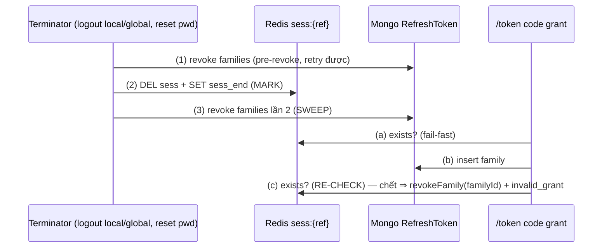

# Tech Lead Review — 2026-10-12

## Kết luận: PASS (kèm chỉnh sửa bắt buộc đã fold vào `tasks.md`, đánh dấu *(tech-lead fold)*)

Đối chiếu code thật (CodeGraph): `authentication.service.ts:172-186` (`resetPassword`), `authentication.module.ts` (chỉ import `IdentityModule`), `token.controller.ts:169-185` (`exists` → `issueForAuthorizationCode`), `token.service.ts:76-152` (sign AT → insert family → audit `TOKEN_ISSUED`), `refresh-token.service.ts:352-449` (`revokeFamily`/`revokeAllForUser`/`revokeForSession` → `revokeWhere` stamp-first), `ui.controller.ts:248-261` (logout: revoke family → revoke session), `session.service.ts:145-269` (`establish`→`revoke`→`revokeRef` luôn ghi tombstone; `get()` quá absolute → `revokeRef`), `authorize.service.ts:204-210` (nhánh covered), `authorize-request-context.service.ts:31` (key `authz_ctx:`), `consent.service.ts:100-140`, `validation.schema.ts:61-62`, `sync-indexes.ts`, mongoose 9.10.2 (`updatePipeline`).

Plan đúng vấn đề, 5 task atomic, nhãn [BE] đúng, không over-engineering. Nhưng có **1 lỗi thiết kế làm DEBT-051 không đóng được** (V1) và vài khẳng định sai so với code (V2–V6). Tất cả sửa được bằng fold, không cần quay lại analyst.

## Kiến trúc đề xuất (điều chỉnh)

Giữ modular monolith; không thêm module/service/abstraction. Chuẩn hoá **một** giao thức chấm dứt phiên dạng mark-then-check hai phía (cùng họ INV-11):

Chứng minh: insert (b) xảy ra trước SWEEP (3) ⇒ SWEEP bắt; xảy ra sau (3) ⇒ sau MARK (2) ⇒ RE-CHECK (c) thấy chết ⇒ tự revoke. Không còn interleaving nào để lại family sống gắn phiên đã chấm dứt chủ động.

## Quyết định chốt

### Q1 — DEBT-051: re-check đặt ở **controller** (bác đề xuất B của analyst)
- Đề xuất B không khả thi như viết: `issueForAuthorizationCode` nằm ở **`TokenService`**, không phải `RefreshTokenService`. `RefreshTokenService` đã inject `TokenService` ⇒ để `TokenService` gọi `revokeFamily` sẽ tạo **vòng DI**; còn tự `updateMany` trong `TokenService` thì phá DEBT-034 (`revokeWhere` là cửa revoke duy nhất).
- `TokenController` đã inject sẵn cả `SessionService` lẫn `RefreshTokenService` ⇒ chỉ cần `TokenService.issueForAuthorizationCode` trả thêm `familyId?` nội bộ (không ra HTTP/log). "Rò `familyId` ra controller" không phải rủi ro bảo mật (server-side).
- **KHÔNG** dùng `revokeForSession(userId, sessionRef)` để dọn: nếu phiên chết do idle-expiry đúng trong cửa sổ, nó sẽ giết luôn family `offline_access` cũ của phiên đó ⇒ vi phạm §8 giới hạn (1). Chỉ `revokeFamily(familyId, clientId, now)`.
- Re-check chỉ cần `exists` (tombstone luôn ghi cùng MULTI với DEL ⇒ `isEnded` thừa). Re-check chạy cả khi không mint refresh (không trả AT cho phiên đã chết — INV-29).
- **V1 (bắt buộc):** chỉ thêm re-check là CHƯA đủ. Logout hiện revoke family **trước** revoke session ⇒ interleaving: logout revoke family → /token insert → /token re-check (phiên vẫn sống) → logout DEL session ⇒ family sống 30d. Phải thêm **SWEEP** (revoke family lần 2 sau khi revoke session) ở logout local/global và reset password.

### Q2 — DEBT-052: chọn **Phương án A** (không tombstone ở `establish(oldId)` và `get()` quá absolute)
- `revokeRef` dùng chung với logout ⇒ thực hiện bằng tham số private `tombstone = true` (mặc định an toàn: mọi đường công khai giữ tombstone); chỉ `establish` và nhánh absolute của `get()` truyền `false`. Không thêm API public.
- `prompt=login`/`max_age`/re-login **KHÔNG** chấm dứt AT/refresh cũ. Lý do:
  - Re-auth là chứng minh *thêm* sự hiện diện của user, không phải tín hiệu xâm phạm; người dùng có đủ đường chủ động (logout, logout toàn cục, thu hồi thiết bị, reset mật khẩu).
  - SSO: step-up ở RP A không được làm hỏng token của RP B trên cùng trình duyệt (B mất AT ~16' trong khi refresh vẫn xoay — đúng lỗi lệch DEBT-052).
  - Absolute-expiry = hết hạn tự nhiên; hiện nó chỉ ghi tombstone khi `get()` tình cờ chạy sát deadline (thường key tự hết PX trước) ⇒ hành vi ngẫu nhiên. A làm nó tất định, khớp §8 giới hạn (1) và test idle hiện có.
- Phương án B bị bác: phá `offline_access` (OIDC Core §11), tăng tải revoke ở mọi lần login.
- Trường hợp đổi tài khoản trên máy dùng chung (user Y login đè cookie user X): token của X sống như hết hạn tự nhiên — chấp nhận; ghi spec rõ.

### Q3 — DEBT-026: đóng bằng test hồi quy, không sửa code
Xác nhận: nhánh covered (`authorize.service.ts:204-210`) gọi thẳng `issueCode`, không `createContext`. Hai phần còn lại của DEBT-026 cũng đã có: `grant` lọc theo `allowedScopes` (`consent.service.ts:119-120`); version env `z.string().min(1)` (`validation.schema.ts:61-62`). Key ctx thật là **`authz_ctx:*`** (tasks ghi sai `authz_req:*`).

### DEBT-050 — thứ tự & fail-closed
- Thứ tự chốt: `validatePassword` → hash → `consume` → `setPassword` → **revoke families** → **revoke sessions** (MARK) → **revoke families (SWEEP)** → audit.
- `setPassword` PHẢI trước revoke: nếu revoke trước, kẻ biết mật khẩu cũ có thể login giữa revoke và setPassword ⇒ phiên mới sống sót.
- Family trước session: lỗi giữa chừng thì credential 30d đã chết trước; SWEEP đóng race với /token.
- Revoke lỗi ⇒ **reset báo thất bại (5xx)**, KHÔNG nuốt, KHÔNG rollback mật khẩu (rollback = bật lại mật khẩu có thể đã lộ). Trạng thái sau lỗi: mật khẩu mới có hiệu lực, link đã tiêu; phục hồi = yêu cầu link mới (revoke idempotent chạy lại) hoặc login bằng mật khẩu mới rồi logout toàn cục. Không báo "thành công" khi credential cũ còn sống.
- DI: `AuthenticationModule` phải import `OauthModule` (export `RefreshTokenService`); không vòng (OauthModule không import Authentication/Ui). `authentication.int-spec.ts`/`.service.spec.ts` đang mock providers ⇒ thêm mock `RefreshTokenService`; test E2E thật đặt ở `refresh-token.int-spec.ts` hoặc `ui-auth.int-spec.ts`.

## Điểm mạnh
- Bám đúng backlog, có security invariants/abuse/failure/exposure cho từng task; tái dùng harness `gateInsert`.
- Task 4 nhận ra union phải ∩ `allowedScopes`; Task 5 fail-closed khi build unique index lỗi, không tự xoá dữ liệu.
- Nêu rõ § spec cần đổi, không tự sửa spec.

## Vấn đề (đã fold — dev bắt buộc làm theo bản fold)
- [x] V1: thêm SWEEP ở logout local/global (`ui.controller.ts:252-261`) và reset password; re-check `/token` ở controller, revoke đúng `familyId`, không `revokeForSession`.
- [x] V2: Task 2 ghi sai vị trí `issueForAuthorizationCode` (TokenService) — đề xuất B gây vòng DI.
- [x] V3: Task 1 thiếu bước DI (`AuthenticationModule` → `OauthModule`) và semantics khi revoke lỗi sau `setPassword`.
- [x] V4: Task 4 pipeline: mongoose 9 **ném lỗi** khi update là mảng nếu thiếu `{ updatePipeline: true }`; giá trị trong pipeline **không cast** và chuỗi bắt đầu bằng `$` bị hiểu là field path ⇒ bắt buộc bọc `{ $literal: [...] }` cho scope request/allowed (chống injection field path); `$setUnion` không giữ thứ tự ⇒ test so sánh dạng tập.
- [x] V5: Task 4 key ctx là `authz_ctx:*`.
- [x] V6: Task 5: test index hiện có đã assert Consent đúng key; acceptance mới phải **tạo index cũ** `{userId:1,clientId:1}` unique trước rồi sync ⇒ thấy nó trong danh sách dropped. Runbook đặt ở file bền (`docs/agile/sso-idp/runbook-deploy.md`), không trong thư mục run.
- [x] V7: văn bản cập nhật spec §8 (giới hạn 1), §9.8, §14, §15 INV-28/29 (gồm bỏ nhãn "(Task 3)" — một phần DEBT-053) — dev áp trong cùng commit.

## Đề xuất (không bắt buộc)
- DEBT-055 (backlog): reset password lỗi hạ tầng sau `setPassword` ⇒ không có audit `AUTH_PASSWORD_RESET` (mật khẩu đổi mà không có event). Cân nhắc audit `result:'failure'` best-effort trong nhánh catch.
- Nhãn audit cho re-check `/token` thất bại: ghi `TOKEN_REVOKED` `metadata:{reason:'session_ended', count}` (không token/ref) — đã fold là yêu cầu nhẹ.