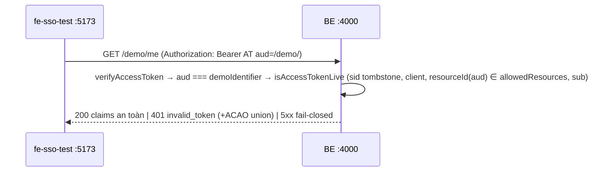

# Tech Lead Review — 2026-10-14 — Lượt 2

## Kết luận: PASS (đã fold 3 chỉnh nhỏ vào `tasks.md` Task 0)

Phân công: **backend-dev** Task 0 → Task 1; **frontend-dev** Task 2 song song, rồi Task 3 sau khi 0+1+2 xong. E2E (T4) + T5 → run 25.

### Kiểm phần fold
- [x] Task 0 có đủ 3 call-site, đã đối chiếu code: `access-token-liveness.ts:74`, `refresh-token.service.ts:118/:252`, `introspect.controller.ts:157`. Grep `allowedResources` toàn `be/src` không còn chỗ so sai nào khác. `authorize.service.ts:403` đã đúng.
- [x] Fixture: liệt kê đủ 5 spec dùng URI (token/refresh/userinfo/introspect/session-reflection), không giữ chế độ chấp nhận cả hai dạng.
- [x] Acceptance (a) dương với client seed-dev, (b) âm, (c) URI trong `allowedResources` thì không live, (d) mutation. Có repro trên DB `sso-idp-e2e` (chỉ đọc).
- [x] Q-24.1/2/3 và các điểm phụ đã fold đúng vào T1/T2/T3. Phân công và thứ tự phụ thuộc rõ. Việc tách E2E sang run 25 hợp lý: run 24 còn 4 task, và E2E chỉ chạy được khi 0–3 xong. Run 25 vẫn giữ assert `/userinfo` 200 để chặn hồi quy Task 0.
- [x] Wiring khả thi: `ResourcesModule` đã được `OauthModule` import (`oauth.module.ts:30`). `ConditionalModule` có sẵn trong `@nestjs/config` 12.0.1. `Resource.identifier` unique, còn `resourceId` không unique (DEBT-077) và đã có điều khoản xử lý.

### Chỉnh nhỏ đã fold thẳng vào Task 0
1. **Introspect giữ anti-oracle DEBT-040**: nếu mapping bằng `findByIdentifier(claims.aud)` *trước* authz thì sinh I/O phụ thuộc nội dung token cho caller không liên quan. Chốt: kiểm `client_id === caller` trước, sau đó tra Resource theo **resourceId của caller** (`identifiersFor(caller.allowedResources)`). Thêm test (b2): caller RS không giữ `demo` thì `active:false` và không gọi `users.exists`/`sessions.isEnded`.
2. **Test (a) phải đi đúng nhánh**: `fe-sso-test` là public, không introspect được. Caller introspect phải là client **confidential** RS khác `clientId`, nếu không test sẽ đi tắt qua `client_id === caller` và không chạm mapping. Client/resource dựng từ `buildSeedDevTargets`.
3. **Fail-closed đo được (e)**: lookup Resource ném lỗi thì liveness reject. `/userinfo` 5xx, `/introspect` 500 `server_error`, refresh 5xx và không rotate (`revokedAt` vẫn null). Mutation (d) áp cho **từng** call-site. Cập nhật caller trực tiếp `isAccessTokenLive` trong `refresh-token.int-spec.ts:1374`.

### Ảnh hưởng spec
Không đổi spec. Spec §7 (dòng 174) đã chốt `allowedResources[]` = resourceId, §577 cũng vậy. Đây là lỗi hiện thực, không phải lỗi spec. Lưu ý cho orchestrator/tester: các run 14–20 báo xanh cho `/userinfo`, refresh, `/introspect` chỉ đúng với fixture URI. Với client đăng ký đúng spec (seed-dev), ba endpoint này **hỏng từ trước**: refresh luôn `invalid_grant`, `/userinfo` 401, `/introspect` `active:false`. Lỗi là fail-closed (từ chối nhầm), **không** lộ quyền, nên không cần cảnh báo bảo mật. Summary run 24 cần ghi rõ là đã sửa hồi quy chức năng này.

---

# Tech Lead Review — 2026-10-14 — Lượt 1

## Kết luận: REJECT

Lý do chính: **blocker ẩn ở BE**. Nhánh 200 của `/demo/me` (T1), nút A/C (T3) và E2E (T4) **không thể xanh** với code hiện tại. Q-24.1/2/3 đã chốt bên dưới. Analyst thêm Task 0 + sửa T1/T3/T4 theo mục "Vấn đề" rồi trả lại tech-lead (lượt 2 chỉ cần kiểm phần fold).

### Bằng chứng blocker (code + dữ liệu thật, chỉ đọc)
- `Client.allowedResources[]` lưu **resourceId** (spec §7 dòng 174; `ResourceService.resolveForClient` dùng resourceId; seed-dev `allowedResources: ['demo']`).
- `aud` của access token và `RefreshToken.resource` lưu **identifier URI** (`authorize.service.ts` `resolveResource` trả `resource.identifier`; `token.service.ts` `audience: resource`).
- Ba chỗ so sánh **URI với resourceId**:
  1. `access-token-liveness.ts:74` `client.allowedResources.includes(claims.aud)` ⇒ token của `fe-sso-test` luôn **không live** ⇒ `/userinfo` 401, `/introspect` `active:false`, và `/demo/me` (tái dùng liveness) 401.
  2. `refresh-token.service.ts:118` và `:252` `resource: { $in: client.allowedResources }` ⇒ refresh của `fe-sso-test` luôn `invalid_grant`.
  3. `introspect.controller.ts:157` `caller.allowedResources.includes(claims.aud)` (authz của resource server gọi introspect).
- DB `sso-idp-e2e`: client `allowedResources: ['demo']`; resource `{resourceId:'demo', identifier:'http://localhost:4000/demo/'}`; refreshtoken `resource: 'http://localhost:4000/demo/'`.
- Int test không bắt được lỗi vì fixture token/refresh/introspect/userinfo ghi **URI** vào `allowedResources` (vd. `token.int-spec.ts:44`, `refresh-token.int-spec.ts:363`), còn `authorize.int-spec.ts:130` ghi resourceId. Hai bộ fixture mâu thuẫn nhau, và E2E run 22/23 chưa gọi `/userinfo`/refresh.

## Kiến trúc đề xuất

Giữ **modular monolith**. Demo-resource là module NestJS riêng `be/src/modules/demo/`, không tách service vì chỉ dùng cho dev/test.

### Chốt Q-24.1 — resource `other`: ĐỒNG Ý
- Seed thêm `{resourceId:'other', identifier:'${issuer}/other/', scopes:[]}`, và `fe-sso-test.allowedResources = ['demo','other']`. **Không** dùng lại `admin`.
- Token cho `other` xin bằng **luồng authorize thứ 2** (BE chỉ bind 1 resource mỗi grant; refresh không đổi resource — INV-12 / `refresh-token.service.ts:125`; không có token exchange). Scope của luồng probe = **`openid` duy nhất**: không `offline_access` nên không sinh refresh family mồ côi. ID token của probe vẫn được validate (nonce/iss/aud) rồi bỏ đi.

### Chốt Q-24.2 — bật `/demo/me`
- Module riêng `DemoModule` (controller `GET /demo/me`), nạp vào `AppModule` bằng `ConditionalModule.registerWhen(DemoModule, (env) => env.NODE_ENV === 'development' || env.NODE_ENV === 'test')` (`@nestjs/config` 12 đã có).
- Dùng **allowlist**, không dùng `!== 'production'`: khi `NODE_ENV` không được set thì zod default `development`, nên kiểm theo raw env ⇒ không set = **tắt**. E2E/CI chạy `NODE_ENV=test` ⇒ bật.
- Phòng thủ chiều sâu: controller đọc `app.nodeEnv` từ config, nếu `production` thì 404 (không cần nếu module đã không nạp, nhưng có test).
- CORS preflight: **không** thêm cứng `/demo/me` vào `CORS_PREFLIGHT_PATHS`. Mở rộng `registerCorsPreflight(fastify, cors, extraPaths?: ReadonlySet<string>)`; `main.ts` chỉ truyền `/demo/me` khi demo bật (cùng điều kiện, tách thành hàm `isDemoEnabled(env)` dùng chung cho module và main). Preflight dùng union allowlist như hiện tại.
- Request thật dùng cách của `/userinfo`: nhánh 200 thì ACAO theo **client của token** (`isOriginAllowedForClient(claims.client_id, origin)`); nhánh lỗi thì union. Resource server không cần là client: quyết định CORS dựa trên `client_id` trong token.

### Chốt Q-24.3 — `/tokens`: ĐỒNG Ý
Chỉ hiển thị metadata (có/không access/ID/refresh, đếm ngược `accessTokenExpiresAt`) và claims ID token đã decode. **Không** render chuỗi token thô, **không** decode payload access token. `Session` hiện không có `token_type` ⇒ bỏ `token_type` hoặc hiển thị hằng `Bearer`; không thêm field vào `Session` chỉ để hiển thị.

### Chốt các câu hỏi phụ
- **Scope ở `/demo/me`**: resource `demo` có `scopes: []` ⇒ **không** đòi scope riêng, không có nhánh 403. Vẫn bắt buộc claim `scope` tồn tại (do verifier). Bỏ bước 4 "nếu chốt" khỏi T1.
- **Tombstone `sid`**: tái dùng `isAccessTokenLive` ⇒ sau logout (`sess_end:{ref}`), cùng AT gọi `/demo/me` phải **401 ngay**, không đợi `exp`. Bắt buộc có int test. AT không có `sid` (pre-B4.7) sống tới `exp` (DEBT-048, chấp nhận).
- **FE gọi `/demo/me`**: `fetch` với header `Authorization: Bearer <AT in-memory>`, `credentials: 'omit'` (không cookie), `cache: 'no-store'`, timeout bằng `AbortController` 10s. Lỗi mạng/CORS ⇒ panel "network error", không crash.
- **Không mất phiên chính**: SPA giữ token in-memory, nên điều hướng toàn trang **chắc chắn** xoá session RP. Popup + postMessage vướng COOP của helmet (`same-origin` mặc định trên :4000 cắt `window.opener`); iframe bị `frame-ancestors 'none'` chặn. Chốt luồng **redirect chuỗi**:
  1. Nút B: tạo transient `{purpose:'aud-probe', returnTo:'/api-test', …}`, rồi `/authorize?resource=${issuer}/other/&scope=openid`. IdP session cookie còn ⇒ không phải login lại; lần đầu có consent cho `other`.
  2. `/callback` thấy `purpose='aud-probe'`: đổi code, validate ID token, gọi `/demo/me` bằng AT `other`, rồi ghi **chỉ** `{status, expected:401, aud}` vào `sessionStorage` (key `oidc:probe_result`, không token). Bỏ token probe khỏi bộ nhớ.
  3. Ngay sau đó `startLogin({ prompt:'none', returnTo:'/api-test' })` với resource `demo` + scope gốc để dựng lại phiên chính (consent `demo` đã có). Nếu `login_required`/`consent_required`/`interaction_required` ⇒ chuyển sang login tương tác (fail-closed, không vòng lặp: tối đa 1 lần `prompt=none` mỗi probe).
  4. `/api-test` đọc rồi **xoá** `oidc:probe_result` (một lần) để hiển thị PASS/FAIL.
  - Trước bước 1, FE gọi `/revoke` cho refresh token hiện tại (best-effort) để không bỏ lại family mồ côi. Nếu revoke lỗi thì vẫn tiếp tục.
- **`returnTo` chống open-redirect**: chỉ nhận chuỗi bắt đầu bằng `/`, không bắt đầu `//` hay `/\`, không chứa `\`, ký tự điều khiển hay scheme; và `new URL(v, location.origin).origin === location.origin`. Validate **cả khi ghi lẫn khi đọc** (transient trong sessionStorage là input không tin cậy). Sai ⇒ `/`. `returnTo` đi qua transient, không qua `state`.

## Điểm mạnh
- Khảo sát codebase đúng ở hầu hết điểm: verifier không pin `aud`, liveness dùng chung, CORS per-client, seed idempotent, token in-memory.
- Q-24.1 chọn `other` thay vì `admin` là đúng nguyên tắc least privilege.
- Bất biến exposure (không token thô ở DOM/URL/log, 401 opaque, không echo `error_description`) đã có và đo được.

## Vấn đề (bắt buộc sửa)
- [ ] **Thêm Task 0 [BE] — sửa so sánh resourceId vs URI** (chặn T1/T3/T4). Hướng thiết kế:
  - Chuẩn hoá: `allowedResources` = resourceId (theo spec §7). Mọi chỗ so `aud`/`resource` (URI) thì resolve qua `Resource`:
    - liveness: `resourceIdOf(aud)` (tra theo `identifier`) ∈ `allowedResources`. Thêm `ResourceLookup` vào `isAccessTokenLive`.
    - refresh (pre-check + rotate): `$in` dùng **identifiers** của các resourceId được phép (1 query `find({resourceId:{$in}})`).
    - introspect caller authz: cùng mapping.
  - Resource không tồn tại hoặc bị đổi identifier ⇒ không live / `invalid_grant` (fail-closed). Mongo lỗi ⇒ propagate 5xx, không nuốt thành `false`.
  - Sửa fixture int test đang ghi URI vào `allowedResources` (token/refresh/introspect/userinfo/session-reflection) sang resourceId + tạo `Resource` tương ứng. **Không** giữ chế độ chấp nhận cả hai dạng (mập mờ, mở đường confused deputy giữa id và URI).
  - Acceptance âm/dương: (a) int test end-to-end với client seed-dev thật: code→token→`/userinfo` 200 → refresh 200 → `/introspect` `active:true`; (b) xoá `'demo'` khỏi `allowedResources` ⇒ `/userinfo` 401, refresh `invalid_grant`, introspect `active:false`; (c) `allowedResources` chứa **URI** (dữ liệu sai) ⇒ không live (không fail-open); (d) mutation: hoàn tác mapping ở liveness hoặc refresh ⇒ (a) RED.
  - Security: tài sản = ranh giới resource (INV-8/INV-14). Abuse: client giữ resourceId X nhưng token `aud` = identifier của Y ⇒ từ chối. `resourceId` không unique (DEBT-077) ⇒ mapping lấy mọi identifier khớp, test duplicate không mở rộng quyền ngoài các resourceId được phép.
- [ ] **T1**: thay bước 4 bằng "không đòi scope (demo `scopes: []`), không 403". Thêm acceptance: logout (tombstone `sid`) ⇒ cùng AT 401 ngay. Mongo/Redis lỗi ⇒ 5xx, body không lộ chi tiết. `NODE_ENV` không set ⇒ 404 (allowlist). Preflight `/demo/me` chỉ 204 khi demo bật; demo tắt ⇒ không có preflight 204. Body 200 **không** chứa `sid` (DEBT-047). Header `Cache-Control: no-store` + `WWW-Authenticate: Bearer error="invalid_token"`. Wiring và CORS theo Q-24.2 ở trên. Seed: test 2 lần ⇒ đúng 2 resource, `allowedResources` = `['demo','other']` không trùng. Cập nhật `seed-dev.int-spec.ts:107`.
- [ ] **T3**: thay "qua luồng authorize lại hoặc endpoint hỗ trợ" bằng luồng redirect chuỗi ở Q-24.1/câu hỏi phụ (transient `purpose`, probe chỉ `openid`, kết quả probe chỉ lưu status, khôi phục bằng `prompt=none`, fallback tương tác tối đa 1 lần). Acceptance: sau nút B, đang ở `/api-test`, vẫn đăng nhập với **cùng `sub`**, panel B "PASS 401"; `sessionStorage` không chứa token và `oidc:probe_result` đã bị xoá sau khi hiển thị; callback với `purpose` lạ hoặc thiếu ⇒ xử lý như login thường, không gọi `/demo/me`. Nút A/C phụ thuộc Task 0.
- [ ] **T2**: `returnTo` theo quy tắc ở trên, đi qua transient, validate khi ghi và khi đọc. Unit test bảng giá trị: `https://evil`, `//evil`, `/\evil`, `javascript:…`, `/%2F%2Fevil`, chuỗi có ký tự điều khiển ⇒ `/`; `/profile?x=1` ⇒ giữ nguyên. `/callback` hiện `redirect("/")` cứng ⇒ đổi sang redirect tới `returnTo` đã validate.
- [ ] **T4 (E2E)**: lấy secrets bằng cách chặn **mọi** response `/token` (gồm luồng probe và luồng khôi phục), không chỉ response đầu. Xử lý consent `other` có thể có hoặc không (lần chạy thứ 2 đã có consent). Assert sau nút B: `sub` ở `/profile` trùng trước đó. Thêm 1 assert `/userinfo` 200 (nút C) để chặn hồi quy Task 0.
- [ ] **Thứ tự / phân công**: Task 0 → T1 (backend-dev); T2 song song (frontend-dev); T3 sau T0+T1+T2; T4 sau cùng.

## Đề xuất (không bắt buộc)
- Tách `bearerToken()` (đang private trong `userinfo.controller.ts`) thành helper dùng chung cho `/userinfo` và `/demo/me`, tránh hai regex lệch nhau.
- Đã đưa vào backlog: DEBT-098 (NODE_ENV không set ⇒ default `development`, fail-open toàn hệ thống), DEBT-099 (popup/BroadcastChannel cho token resource phụ mà không dựng lại phiên).